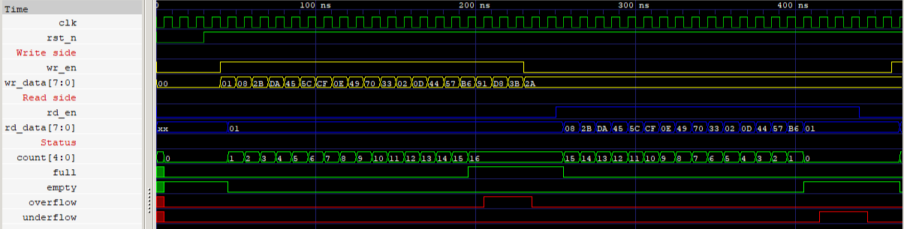
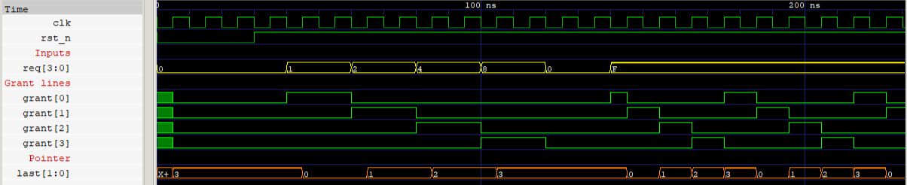

# Synchronous FIFO + Round-Robin Arbiter

Two small, self-checking Verilog designs, built to practice RTL design and testbench writing.

## Designs

- **`sync_fifo.v`** — 8-bit wide, 16-entry deep synchronous FIFO with `full`, `empty`, overflow, and underflow flags.
- **`rr_arbiter.v`** — 4-requester round-robin arbiter.

## Testbenches

- **`tb_sync_fifo.v`** — self-checking against a reference model (a simple queue), reports `TEST PASSED`/`TEST FAILED`.
- **`tb_rr_arbiter.v`** — checks four correctness properties every cycle (one-hot grant, grant implies request, fairness/rotation, no grant when idle).

## Running it

Requires [Icarus Verilog](https://bleyer.org/icarus/).

```bash
./run_all.sh
```

This runs both testbenches against the correct RTL (should print `TEST PASSED`), then re-runs them six times with a bug injected via `` `define `` flags (`BUG_FULL_OFF_BY_ONE`, `BUG_NO_OVERFLOW_PROTECT`, `BUG_SIMUL_RW`, `BUG_FIXED_PRIORITY`, `BUG_GRANT_IDLE`, `BUG_NO_ROTATE`) — each of those should print `TEST FAILED`, confirming the checkers actually catch bugs.

## Waveforms

Captured in GTKWave from the passing simulations. `x` values before the first clock edge are expected: registers have no value until the synchronous reset is applied, and `rd_data` is `xx` until the first write.

### FIFO: fill to full, overflow, drain, underflow



- `count` climbs to 16 and `full` goes high. The next three writes (`91`, `D8`, `3B`) are rejected, and `overflow` stays high for those three cycles.
- `rd_data` then returns `01, 08, 2B, ...` in the order written, and `count` falls to 0.
- `empty` goes high, and the three extra reads raise `underflow` without changing `count`.

### Arbiter: single requesters, then round-robin



- A lone requester (`req` = `1`, `2`, `4`, `8`) is granted for as long as it requests, and nothing is granted when `req` = `0`.
- With all four requesting (`req` = `F`), exactly one grant is active per cycle, rotating 0, 1, 2, 3. `last` tracks the most recent grant.

To open the same views yourself, run `./run_all.sh` to generate the VCD files, then:

```bash
gtkwave build/fifo.vcd waves/fifo.gtkw
gtkwave build/arbiter.vcd waves/arbiter.gtkw
```

## Scope

This is RTL-level verification with directed/self-checking testbenches in plain Verilog. It does not include SVA, UVM, functional coverage, or an FPGA build — none of that is claimed here.
